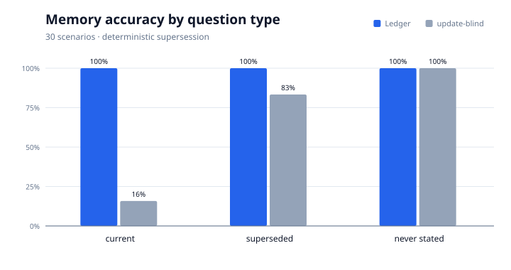
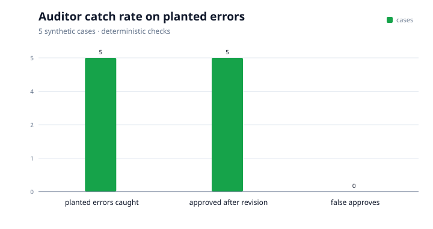

# The four numbers

Generated by `make results`. **Do not edit by hand** — re-run the target.

Every number below is drawn from **synthetic test data** and is a test-set result, not a general guarantee. Each is read from an artifact in `eval/results/`. The packer refuses to draw a number whose artifact is missing, stale, or too small to mean anything.

| # | Number | Status | Detail | Artifact |
|---|---|---|---|---|
| 1 | Leak rate, router OFF → ON | **READY** | 200 documents; OFF 100.0%, ON 0.0% | `eval/results/leak_test.json` |
| 2 | Memory with updates | **READY** | 30 scenarios | `eval/results/memory_eval.json` |
| 3 | Cost and latency per tier | **READY** | 60 calls, 0 error(s), measured 2026-10-28T16:57:14+00:00 | `eval/results/cost_latency.json` |
| 4 | Auditor catch rate | **READY** | 5 planted cases; 5 caught, 0 false approve(s), 0 false reject(s), 5 approved after revision | `eval/results/auditor_eval.json` |

## 1. Leak rate, router OFF → ON

| Condition | Payloads | With a personal detail | Leak rate |
|---|---:|---:|---:|
| router OFF | 200 | 200 | **100.0%** |
| router ON | 200 | 0 | **0.0%** |

Source: artifact above, 200 documents, reference date 2026-10-20.

## 2. Cost and latency per tier

| Tier | Model | Calls | Errors | Mean ms | p95 ms | Cost/call | $/1k calls |
|---|---|---:|---:|---:|---:|---:|---:|
| Nano | `nvidia/NVIDIA-Nemotron-3-Nano-30B-A3B` | 20 | 0 | 10212 | 18432 | $0.000103 | $0.10 |
| Super | `nvidia/Nemotron-3.5-Super-VL` | 20 | 0 | 3544 | 6945 | $0.000704 | $0.70 |
| Ultra | `nvidia/Nemotron-3-Ultra-550b-a55b` | 20 | 0 | 3844 | 6530 | $0.001059 | $1.06 |

Measured 2026-10-28T16:57:14+00:00 at `https://api.tokenfactory.nebius.com/v1`, 5 repeats per prompt, pricing from the live catalog (30 models). Total spend $0.0373.

## 3. Memory with updates

| Question type | InkWell | Update-blind baseline |
|---|---:|---:|
| current fact after a supersession | 100.0% | 15.8% |
| the superseded fact, at a point in time | 100.0% | 83.3% |
| abstention on a never-stated subject | 100.0% | 100.0% |
| **overall** | **100.0%** | **43.3%** |

30 scenarios. Method: deterministic SQLite fact supersession; no model call. Measured 2026-10-28T17:33:08+00:00.

## 4. Auditor catch rate

| Case | Planted error | First pass | Final | Codes |
|---|---|---|---|---|
| `case-00-clean-baseline` | Unmodified template draft — the control case. | approve | approve | — |
| `case-01-wrong-amount` | Draft states a wrong amount. | reject | approve | amount_mismatch |
| `case-02-uncited-claim` | Draft contains an uncited claim. | reject | approve | uncited_claim |
| `case-03-promised-outcome` | Draft promises an outcome. | reject | approve | uncited_claim, promised_outcome |
| `case-04-wrong-date` | Draft states a wrong renewal date. | reject | approve | date_mismatch |
| `case-05-unexpected-personal-data` | Draft carries an email address the letter does not need. | reject | approve | unexpected_personal_data |

**5 of 5 planted errors rejected on the first pass (100.0%)**; 0 false approve(s), 0 false reject(s) on the clean control; 5 approved after a deterministic revision, 5 with both rounds in the trace.

Synthetic cases in `eval/auditor_cases/`. Method: Deterministic Auditor over the real orchestrator; each planted error is injected by a Drafter override, then the deterministic revision is re-audited. Measured 2026-10-29T07:40:16+00:00.

## What these numbers do not prove

- **The leak test measures what would leave, not what the far end does.** It captures the request at `privacy_router/egress.py` and returns a canned answer; no network, no API key.
- **The leak headline is the lookup path.** `ocr_call` is 0 in both conditions because the local extractor read every document, so no image left the machine. That is a result, not a gap, but it is not a claim about vision models.
- **Latency is this host, this network, this hour.** It is a comparison between tiers under the same conditions, not an SLA.
- **The memory score is deterministic SQLite supersession**, not model paraphrase quality. It measures whether a changed fact is superseded and history is preserved.
- **The Auditor catch rate is measured on planted, synthetic errors.** It says the deterministic checks catch the five error classes in `eval/auditor_cases/`; it is not a general measure of how many real-world drafting mistakes exist.

## Provenance

- Leak rate, router OFF → ON: `eval/results/leak_test.json` — READY
- Memory with updates: `eval/results/memory_eval.json` — READY
- Cost and latency per tier: `eval/results/cost_latency.json` — READY
- Auditor catch rate: `eval/results/auditor_eval.json` — READY

Charts: `auditor-catch-rate.svg`, `cost-per-1k.svg`, `latency-p95.svg`, `leak-rate.svg`, `memory-accuracy.svg`.
