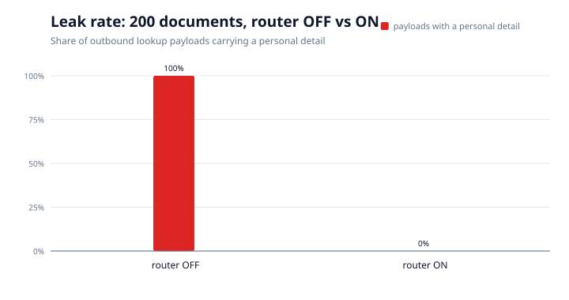
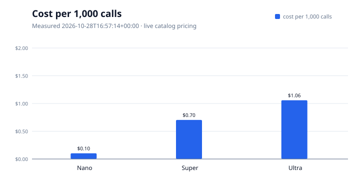
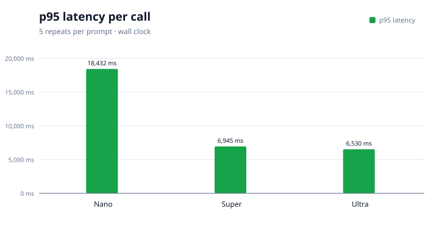

# The three numbers

Generated by `make results` at 2026-10-28 17:09 UTC. **Do not edit by hand** — re-run the target.

Each number below is read from an artifact in `eval/results/`. The packer refuses to draw a number whose artifact is missing, stale, or too small to mean anything.

| # | Number | Status | Detail | Artifact |
|---|---|---|---|---|
| 1 | Leak rate, router OFF → ON | **READY** | 200 documents; OFF 100.0%, ON 0.0% | `eval/results/leak_test.json` |
| 2 | Memory with updates | **NOT READY** | only 3 scenarios (need 20) — a harness check, not a rate | `eval/results/memory_eval.json` |
| 3 | Cost and latency per tier | **READY** | 60 calls, 0 error(s), measured 2026-10-28T16:57:14+00:00 | `eval/results/cost_latency.json` |

## 1. Leak rate, router OFF → ON

| Condition | Payloads | With a personal detail | Leak rate |
|---|---:|---:|---:|
| router OFF | 200 | 200 | **100.0%** |
| router ON | 200 | 0 | **0.0%** |

Source: artifact above, 200 documents, reference date 2026-10-20.

## 2. Cost and latency per tier

| Tier | Model | Calls | Errors | Mean ms | p95 ms | Cost/call | $/1k calls |
|---|---|---:|---:|---:|---:|---:|---:|
| Nano | `nvidia/NVIDIA-Nemotron-3-Nano-30B-A3B` | 20 | 0 | 10212 | 18432 | $0.000103 | $0.10 |
| Super | `nvidia/Nemotron-3.5-Super-VL` | 20 | 0 | 3544 | 6945 | $0.000704 | $0.70 |
| Ultra | `nvidia/Nemotron-3-Ultra-550b-a55b` | 20 | 0 | 3844 | 6530 | $0.001059 | $1.06 |

Measured 2026-10-28T16:57:14+00:00 at `https://api.tokenfactory.nebius.com/v1`, 5 repeats per prompt, pricing from the live catalog (30 models). Total spend $0.0373.

## 3. Memory with updates

**NOT READY.** only 3 scenarios (need 20) — a harness check, not a rate.

## What these numbers do not prove

- **The leak test measures what would leave, not what the far end does.** It captures the request at `privacy_router/egress.py` and returns a canned answer; no network, no API key.
- **The leak headline is the lookup path.** `ocr_call` is 0 in both conditions because the local extractor read every document, so no image left the machine. That is a result, not a gap, but it is not a claim about vision models.
- **Latency is this host, this network, this hour.** It is a comparison between tiers under the same conditions, not an SLA.
- **The memory score is deterministic SQLite supersession**, not model paraphrase quality. It measures whether a changed fact is superseded and history is preserved.

## Provenance

- Leak rate, router OFF → ON: `eval/results/leak_test.json` — READY
- Memory with updates: `eval/results/memory_eval.json` — NOT READY
- Cost and latency per tier: `eval/results/cost_latency.json` — READY

Charts: `cost-per-1k.svg`, `latency-p95.svg`, `leak-rate.svg`.
